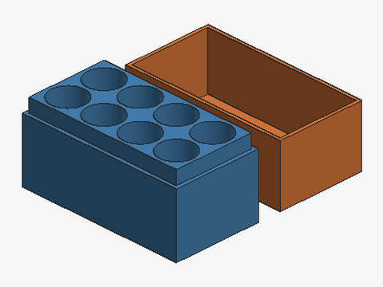
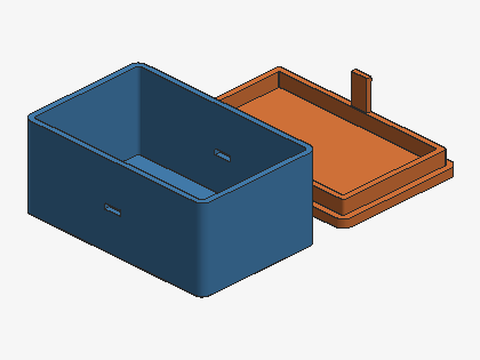
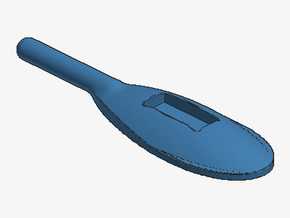
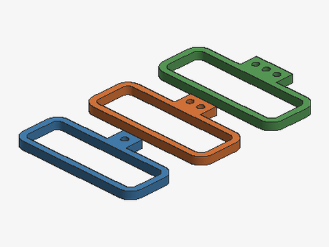
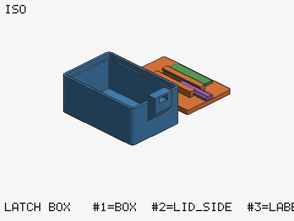
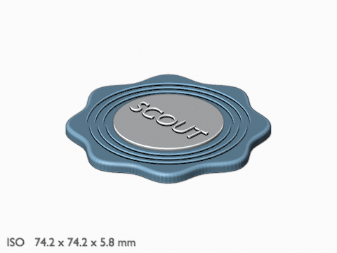

# 3dprint-scout

[한국어](README.ko.md)


An agent skill for designing things to 3D print, **reference-first**.

Tell your agent what you want to make. It first finds existing models and lets you reference one,
mix several, start from scratch, or just print one that already does the job. Then it models the
part, checks it with numbers, and hands you files ready for your printer and slicer. For Bambu
Studio, that is a project file with the print settings already set per object.

## How a request runs

1. **References** — four existing models from Printables, Thingiverse, MakerWorld and others, with
   their licenses. You pick: **A** reference one, **B** mix ideas, **C** original, **D** use as is.
2. **Concepts** — for B and C, two or three quick low-detail variants with preview images, so you
   choose the direction before the detailed work starts.
3. **Printer and slicer** — asked in plain words ("Which printer do you have, and which program do
   you open print files in? It's fine if you don't know the program."). Sensible defaults when you don't know.
4. **Dimensions** — a table of every dimension with its source (your caliper, an official spec,
   or two secondary sources that agree). Nothing is invented. For parts that must fit an object of
   uncertain shape, it makes small fit-test pieces first (three clearance steps, marked 1, 2, 3).
5. **Modeling** — [Blender](https://www.blender.org) first, for every shape, when it is there
   (your own Blender through MCP, a `blender` binary, or the `bpy` module): fillets with a true
   radius, rounds along curves in the profile, Manifold booleans, text in any font, an editable
   `.blend` next to the STLs, and the Python part library's mechanical helpers when Blender's
   Python has [manifold3d](https://github.com/elalish/manifold). Without Blender, Python
   (manifold3d) or OpenSCAD for mechanical parts and Python for organic ones; Fusion (through MCP)
   only when you want an editable CAD design. The Python engine comes with a tested part library (rounded and chamfered boxes, screw and insert holes,
   teardrop holes, bosses, snap hooks, a print-in-place hinge, text, threads) and a
   signed-distance-function toolkit for smooth, blended, organic shapes. Anything
   with its own job or a likely colour of its own (a latch, a lever, a label) is modelled as a
   separate part of the same object, so you can give it another filament in the slicer without
   remodelling; print-in-place pieces keep their clearance.
6. **Verification** — every part is checked: size, bed fit, watertight mesh, overhangs, wall
   thickness, fresh evidence (the STL must match the current source and parameters). An object
   made of several parts is checked as a whole (bed fit, overhang on the union, that fused parts
   touch and free parts keep their gap). Mating parts are checked against each other: overlap,
   play, gap and contact area, and a moving part is swept through its travel to find where it
   hits. Pins, levers and latches that carry load are compared with a proven reference when you
   have one, run through a hand calculation (`strength.py`, with values from Bambu Lab's data
   sheets and a cited hand-force table), and when the margin is short the mechanism alone is
   printed first, a few grams; a print-in-place lid hinge always gets that coupon, on top of
   its margin. Every part gets a preview image (iso, front, right, top) rendered without a
   display, and a Blender render in your filament's colour when Blender is there.
7. **Delivery** — a final report first (`finalize.py`): geometry verified or not, the shape by
   the directions the references cover, and slicing and printing as not verified here, with
   every open item listed; then STL per part plus a 3MF that fits your slicer, with print-setting
   changes and the reason for each, one line naming the separate parts and how to recolour them,
   and a bundle with the generator, the parameters and the commands that rebuild them.

The agent stops for your choice after references, after the concepts, after the dimension table
and after the base shape. If you hand it a file of the thing the part must fit (a manufacturer's
kit, a reference model), it measures the interface dimensions from the file and copies nothing.

## Examples

<p>
<a href="examples/aa-battery-box/"></a>
<a href="examples/snap-box/"></a>
<a href="examples/leaf-handle/"></a>
<a href="examples/fit-test/"></a>
<a href="examples/latch-box/"></a>
<a href="examples/blender-coaster/"></a>
</p>

An AA battery box (OpenSCAD), a snap-fit box (part library), a leaf door handle (SDF toolkit),
fit-test rings, a latch box with a separate colour part and a print-in-place latch, and a
scalloped coaster with embossed text (Blender), built with the skill's scripts. Each comes with
its source, parameters, check results and the commands that rebuild it: see
[examples/](examples/).

## Install

**Claude (web and desktop).** Download `3dprint-scout-v<version>.zip` from the
[latest release](../../releases/latest), then go to **Customize > Skills**, click **+**, choose
**Create skill > Upload a skill**, and upload the zip. Code execution must be enabled
([how skills work in Claude](https://support.claude.com/en/articles/12512180-use-skills-in-claude)).

**Claude Code.** Clone into your personal skills folder (or a project's `.claude/skills/`):

```bash
git clone https://github.com/madrobotnet/3dprint-scout ~/.claude/skills/3dprint-scout
```

**Any agent, one command.** The [skills CLI](https://github.com/vercel-labs/skills) installs it
into Claude Code, Codex, Cursor, OpenCode and many other agents:

```bash
npx skills add madrobotnet/3dprint-scout
```

**Other agents.** The skill follows the [Agent Skills](https://agentskills.io) format and names no
agent-specific tools, so any agent that loads `SKILL.md` skills can use the same folder. Copy it to
wherever your agent reads skills from.

**Or let your agent do it.** Tell it: *"Install the agent skill from
https://github.com/madrobotnet/3dprint-scout."* An agent that can run commands can usually set
it up by itself.

Then just ask, in any language: *"I want a wall hook for a 6 mm dowel"*, *"make a case for this
PCB"*, *"X2D 프린터 문 손잡이를 만들고 싶어"*.

## Requirements

For virtual environments, tested Python/Blender combinations and readiness checks, see
[Development setup](references/development.md). Choose standard-library checks, Python
modeling, or Blender modeling; the Python floor below does not mean bpy has a wheel for
every supported Python version.

- Python 3.9 or newer (tested on 3.9 and 3.13). The validator and the 3MF writers use the standard
  library only.
- One modeling engine: **Fusion** with an MCP connection, **OpenSCAD** (2021.01 or a newer build
  with the Manifold backend), or `pip install manifold3d`. **Blender** is optional and the first
  engine when it is there, and gives renders: your own Blender through an MCP connector, a
  `blender` binary, or `pip install bpy`, each 4.5 LTS or newer (the Manifold boolean solver). The
  [official Blender MCP add-on](https://www.blender.org/lab/mcp-server/) itself needs Blender 5.1
  or newer. Without Blender the other engines do everything, as before.
- `numpy` for preview images, the measuring tool and the contact-area part of the fit check;
  `manifold3d` for the fit check and sweep, the object checks, the fit-test pieces, the part
  library and the SDF toolkit; `rtree` (with numpy) for the wall-thickness check. Text on parts
  needs `matplotlib`, or `fonttools` plus a font file. Each is optional: what is missing is
  reported as unverified or as a clear error, never faked.

## Bambu Studio

For Bambu Lab printers the skill writes a Bambu Studio project (open it with **File > Open
Project**). It needs a template project, made one of two ways:

- **Saved (asked for first).** Save an empty project in Bambu Studio with your printer, filaments
  and print profile and give it to the skill: it keeps your own process tweaks and your exact AMS
  filament set. Such a file contains your preset and your Bambu account ID: the skill blanks the
  ID in every file it writes, but keep the template itself private.
- **Generated (fallback).** `bambu_template.py` writes an empty project that only *names* system
  presets, for example `0.20mm Standard @BBL X2D` and Bambu PLA Basic. When Bambu Studio opens it,
  it fills in every value from the presets installed on your computer. No settings are copied, and
  the file holds no personal data.

An object made of several parts arrives as one Bambu object whose parts are listed by name, each
with its own filament, in their assembled positions. Per-object settings (supports, support
interface filament and distance, brim, walls, infill, layer height and a few more) come only from
an allowlist with range checks. Keys that can run programs or rewrite G-code are never written. On
the X2D and H2D, objects that need both nozzles are placed where both can reach.

## What it writes in your project

| Path | Contents |
|---|---|
| `.3dprint/params.json` | Every dimension, with assumptions taken when you weren't asked |
| `.3dprint/printers.json` | Your printer: bed, nozzles, slicer, template (no serials, access codes or IPs) |
| `.3dprint/calibration.json` | Your own print results (which fit-test ring fit, which latch held or broke), written only after you say yes; a value here beats every table |
| `.3dprint/templates/` | Bambu Studio template. A saved one holds your account ID: keep it private |
| `out/` | Working folder, rewritten on every build: STLs, build manifests, a core 3MF, a `.blend` for Blender builds, preview images, fit-test pieces |
| a new delivery folder | Final files. Existing files are never overwritten |

## Status

**v0.6.1** combines verification fixes with setup and workflow improvements.
Assembly evidence now tracks object membership, roles and free-part clearances separately
from STL geometry: changing those conditions requires a new build report. Older reports
without an assembly fingerprint stay unverified until rebuilt or re-recorded. Engine detection
tries a healthy bpy fallback and checks that OpenSCAD can export a cube. Confirmed answers
are reused, choosing an existing model has its own handoff, and working project updates are
distinguished from overwriting delivered files. Installation recipes and a real Blender
binary smoke check are described in [Development setup](references/development.md).

**v0.6.0** makes Blender the first engine for every shape, after a comparison build (a C-clip and
a card-slot block) measured the same as the Python engine with the new helpers: fillets with a
true radius, rounds along curves in the profile, and the Python part library inside Blender. A
final report (`finalize.py`) gathers every check, fit and strength report, test print and
accepted warning, says what is verified and what is not (shape by direction, slicing and
printing are said to be unverified), and checks that the delivered files are the verified
ones. The calibration log recommends only results printed under the same conditions (nozzle,
layer, load, orientation, process), and never a mix of values from different prints.

**v0.5.1** fixes checks that could pass what they should not, found by an outside review: a
move that passes through an obstacle on its way, a turn checked over less than the travel it
needs (or with a negative travel) or past a stop between two steps, and two print-in-place parts
that touch each other.

**v0.5.0.** The Blender paths ran on a real Windows install (Blender 5.2.2 LTS, the binary and
the official Blender Lab MCP server), and five scenario runs used the skill end to end (an
organic pot, a snap clip, a mixed nameplate, a Gridfinity bin, a Hangul keyring). Their
findings are fixed: renders in the filaments' real colours, text that refuses a character its
font cannot draw, `record` that no longer passes a stale STL, `strength.py snap`, rules for
standards, fonts and two-colour text. Mechanical parts now go to Python or OpenSCAD and Fusion
only when you want editable CAD, after a comparison that measured the same accuracy in Blender
but no reliable rounds next to curved faces. Not yet run: the MCP server's background tool, and
the binary on macOS and Linux.
v0.4.0 uses Blender (4.5 LTS or newer) when it is there: your own Blender through an MCP
connector, a `blender` binary or the `bpy` module. Organic and decorative shapes get real
fillets, Manifold booleans, text in any font and an editable `.blend` next to the STLs;
previews can be Blender renders in the filament's colour. In your own Blender it builds into a
scene of its own and writes only into its output folder: your open file is never
reset, saved or overwritten, and nothing of yours ends up in the `.blend` it delivers. Checked
with the `bpy` module 4.5.14 and 5.2.2 and an emulated binary at release; the real binary and
the MCP server ran in v0.5.0. Without Blender everything works as in v0.3.1.
v0.3.1 splits the mechanism rules by duty after a test request with v0.3.0 (an SD-card
case whose lid hinge was sized by the latch minimums and grew the box): hand-operated latches,
levers and clamps keep the field minimums; lid hinges with alternating knuckles are sized by the
new `strength.py hinge` case at a cited load and confirmed by a coupon print; a mechanism never
silently grows the object; the calibration log keeps floors to the same kind of member
(`--kind`). The hinge case is checked against hand calculation in the tests, not yet against a
printed coupon. v0.3.0 added parts grouped into objects with their own
checks and grouped 3MF writers, a Fusion Builder skeleton, a measuring tool for supplied files, a
rotation sweep in the fit check, strength calculations and a calibration log for members that
carry load, and the process fixes from a field test on 2026-10-17 (a tool-free exhaust adapter
designed in Fusion, printed on an X2D, whose print-in-place latches broke). v0.1.0 and v0.2.0 were tested
end to end on a Bambu Lab X2D with Bambu Studio 02.08.02.61, with OpenSCAD 2021.01 and manifold3d
3.5.4; generated templates were also checked against the A1 mini, A1, P1S, X1C, H2D and H2C
profiles. The v0.3 Bambu projects with several parts in one object, the support interface
settings and the v0.2.1 six-filament fix were checked in the app on 2026-10-18. Not yet run in
Fusion: the cleaned Builder; not yet run: the Blender MCP server's background tool and the
binary on macOS and Linux; not yet tested at all: OrcaSlicer. Planned: a printer-profile importer, bridge
and minimum-feature checks. FDM only; no resin.

## Development

Prepare an environment using [Development setup](references/development.md), then run:

```bash
python3 -m unittest discover -s tests
```

`tests/test_examples.py` rebuilds every example with the commands in its README.
Finish installing dependencies before running tests; do not reinstall bpy while a Blender
subprocess is using it. Skill changes also need the conversation scenarios documented in the
setup guide; Python unit tests alone do not exercise agent decisions.

`SKILL.md` is the entry point: the rules that hold at all times, a short skeleton of each phase
and the checklist. Each phase's how-to (`references/phase-0-detect.md` to `phase-6-deliver.md`),
the engine rules, tolerances and the Bambu details live in `references/` and are read on
entering the phase that names them.

## Contributors

Thanks to everyone who has made 3dprint-scout better:

- [@fivetaku](https://github.com/fivetaku): fit reports that record which STLs they measured, and
  `fit.py --check` ([#9](../../pull/9)); workflow notes from a Blender MCP pipeline
  ([#8](../../issues/8)).

Issues and pull requests are welcome.

## Support

If this skill saved you some time, you can buy me a coffee.

[](https://buymeacoffee.com/madrobotnet)

## License

MIT, see [LICENSE](LICENSE). Bambu Studio's project format was learned from its open-source code;
only file-format constants needed to interoperate are used, and Bambu's profile data is read at run
time (from your installation, or Bambu's public profiles), never shipped.

Not affiliated with Bambu Lab, Autodesk or any other company named here.
