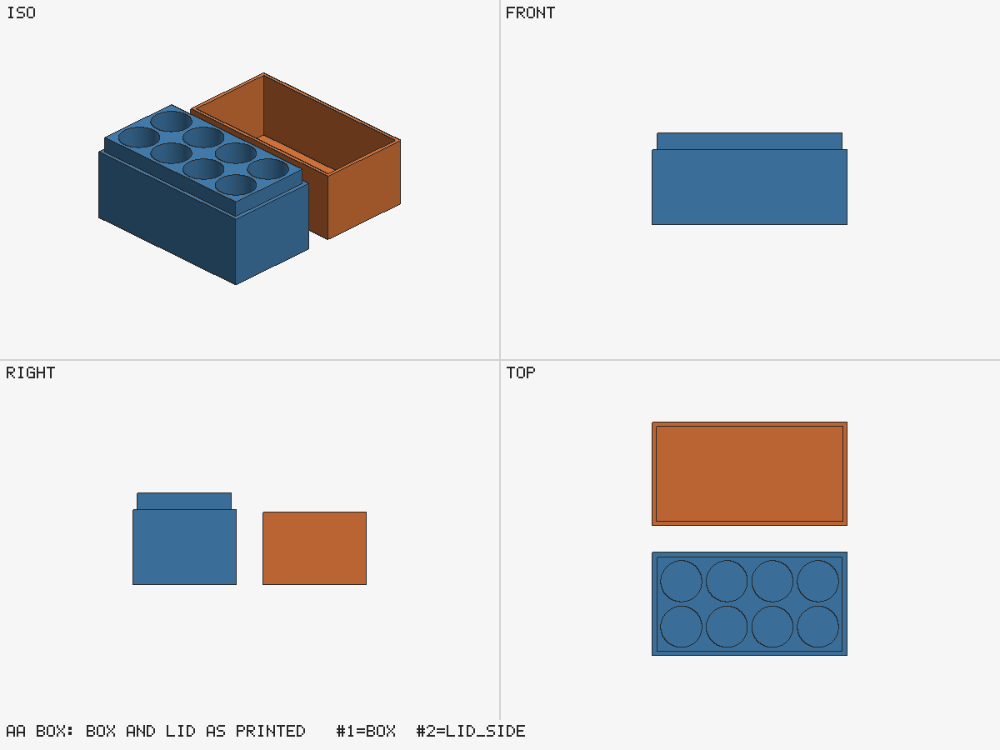

# AA battery box (OpenSCAD)

Eight AA cells in a 4 × 2 block, with a slip-on lid. Mechanical part, so the skill picks a CAD
engine: here OpenSCAD.



## What it shows

- **Dimensions with sources.** The cell size (14.5 mm diameter, 50.5 mm height, maximums) is
  commented with two sources that agree, as the dimension table requires.
- **Clearances from `references/tolerances.md`.** Pockets get 0.3 mm per side (an object in a
  pocket); the lid slides on with 0.2 mm per side. Hole compensation is left to the slicer, so it
  is applied in one place only (F1). The X2D's standard process has circle compensation off
  (`printers.x2d.json` says `"holes": "model"`): turn it on in Bambu Studio for this print, or
  add the model value from `tolerances.md` to `pocket_clear`.
- **Guards in the source.** `assert`s stop the build if a wall or rib gets thinner than 1.2 mm.
- **One source, two parts.** `build.py` sets `part` to `box` and `lid` and checks each against the
  size in `params.json`.
- **The fit check.** The lid is turned over and seated on the box's shoulder; `fit.py` reports no
  overlap, the parts touching, and 0.2 mm of play in ±X and ±Y.

## Build

```bash
python3 ../../scripts/build.py run aa_box.scad --params params.json --out out --printer ../printers.x2d.json --tools 0
python3 ../../scripts/fit.py out/box.stl out/lid.stl --b-rotate 180,0,0 --b-translate 0,37.8,54.2 --min-clearance 0.2
python3 ../place.py out/lid.stl out/lid_side.stl --translate 0,47.8,0
python3 ../../scripts/preview.py out/box.stl out/lid_side.stl -o out/preview.png --overwrite
```

The lid prints opening up. Turned over about X it spans y −37.8…0 and z −26.6…0, so moving it by
(0, 37.8, 54.2) puts its rim on the shoulder at z = 27.6 (box height − lip height) and its ceiling
0.5 mm above the cell tops. `fit_report.json` is the output of the second command.

Expected: build gate `PASS` with no warnings, fit gate `PASS`.
