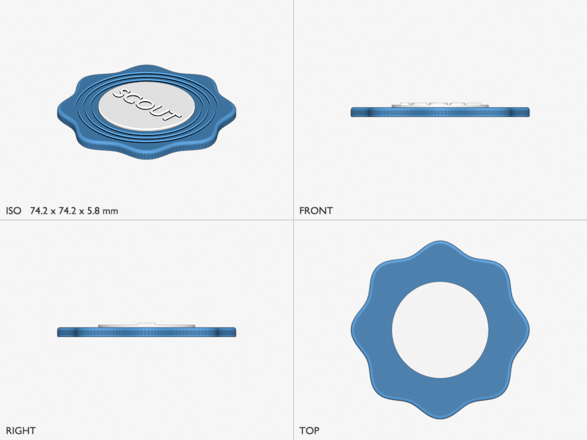

# Scalloped coaster (Blender with blender_builder.py)

A 74 mm coaster with a wavy rim, a real fillet along its top edge, three ring grooves and a
raised medallion in the centre carrying embossed text. A decorative, freeform shape, so the
skill uses the Blender engine (`references/engines/blender.md`), which is only picked when
Blender 4.5 LTS or newer is there: a `blender` binary or the `bpy` module.



## What it shows

- **Real fillets on a freeform body.** `bb.bevel(coaster, 1.2)` rounds the top edge of the
  scalloped prism with Blender's Bevel modifier (five segments, one per line width); the edges
  on the bed are left alone and get `bb.bed_chamfer` instead (P6), cut slightly steeper than
  45° so the overhang check never counts it.
- **Booleans with the Manifold solver.** Each groove is a ring subtracted from the top face
  (Blender's Manifold solver, the same library as `manifold3d`; it is why 4.5 is the floor:
  the older Exact solver left this union open). The builder refuses non-manifold input and a
  non-manifold result instead of cleaning it up.
- **Text, and a colour part.** `bb.text("SCOUT", height=7.0, depth=0.9)` makes the letters from
  Blender's built-in font with a 7 mm cap height (the font's strokes reach about 0.9 mm there,
  above the 0.8 mm text minimum); a union with the disc makes the medallion one body, placed on
  the top face as a `fused` part of the `coaster` object, so you can give it another filament
  in the slicer by selecting it.
- **A readable failure, not a wrong part.** `build()` checks that the outer groove clears the
  fillet and that the letters fit inside the disc; the first draft of this example (60 mm, a
  24 mm disc) stopped with "text 'SCOUT' is 23.8 x 5.1 mm, too wide for the disc".
- **An editable .blend next to the STLs.** `out/coaster.blend` holds the two meshes in a
  `coaster` collection and the parameters as custom properties on a `PARAMETERS` empty, with
  no UI state and no path of the machine that built it (it is written compressed, after an
  uncompressed twin was scanned for such paths). The script stays the source of truth: edit
  a value there (or in `params.json`) and rebuild.
- **Blender renders.** `preview.png` and `thumb.png` come from `render.py`, Blender's
  Workbench engine, headless, with the medallion in Bambu "Jade White" (an approximate screen
  colour; an unknown name would give neutral grey and a warning); `preview.py` would draw the
  same views without Blender.
- **A soft warning, left for you.** The build passes with one warning, P3 on the medallion:
  the 5th-percentile wall thickness from ray casting is the letter strokes, about 1.0 mm,
  under the 1.2 mm wall rule. Text follows the text rule instead (strokes ≥ 0.8 mm,
  `references/design.md`), so in a real request the skill explains it and moves on.

## Build

```bash
python3 ../../scripts/build.py run coaster.py --params params.json --out out --printer ../printers.x2d.json --tools 0
python3 ../../scripts/render.py out/coaster.stl out/medallion.stl -o out/preview.png --size 1200x900 --color "medallion=Jade White" --overwrite
python3 ../../scripts/render.py out/coaster.stl out/medallion.stl -o out/thumb.png --views iso --size 480x360 --color "medallion=Jade White" --overwrite
```

The first line of `coaster.py` (`# 3dprint-scout: engine=blender`) picks the engine; `build.py`
runs the script in the `blender` binary when one is installed, else with the Python that has
`bpy` (`--blender-python PATH` chooses one). The build takes about 3 s, the 1200 × 900 render
about 6 s and the thumbnail about 3 s here (the `bpy` module; a 1600 × 1200 four-view grid takes
about 9 s). Expected: build gate `PASS`, with the P3 warning above; `out/coaster.blend` next to
the STLs and the 3MF. Checked with the `bpy` module 4.5.14 and 5.2.2.

A live Blender (an MCP connection to your own Blender) runs the same script and `build.py
record` takes the STLs; see `references/engines/blender.md`.
