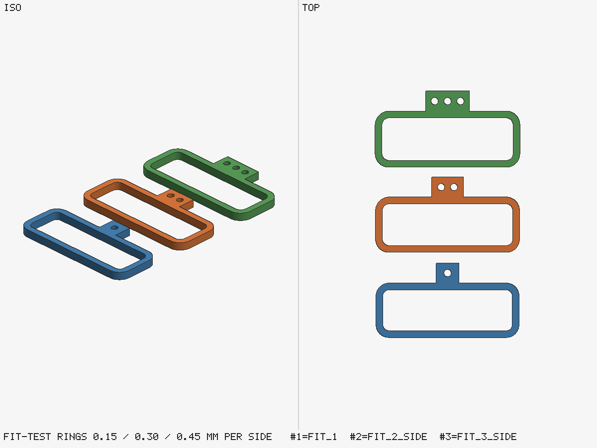

# Fit-test rings (fit_test.py)

Before printing a part that must fit an object of uncertain shape, the skill prints small test
pieces. Here: three rings for a 45.1 × 14.0 mm rounded rectangle (2 mm corners), at 0.15, 0.30 and
0.45 mm of clearance per side.



## What it shows

- **Clearance steps around the middle value.** The middle ring uses 0.30 mm per side, the
  `tolerances.md` value for an object in a pocket; the others step 0.15 mm each way.
- **Marks you can read on the printed piece.** Ring 1 has one hole in its tab, ring 2 two, ring 3
  three, so you can tell them apart off the bed.
- **Small and quick.** Each ring is 3 mm tall and weighs 1.3 to 1.5 g in PLA. Try the object in each
  ring, and the skill uses the clearance of the one that fits.

## Build

```bash
python3 ../../scripts/fit_test.py --profile rounded --size 45.1,14.0 --radius 2 --out out --name fit
python3 ../place.py out/fit_2.stl out/fit_2_side.stl --translate 0,30,0
python3 ../place.py out/fit_3.stl out/fit_3_side.stl --translate 0,60,0
python3 ../../scripts/preview.py out/fit_1.stl out/fit_2_side.stl out/fit_3_side.stl -o out/preview.png --views iso,top --overwrite
```

`out/fit.json` lists each ring's clearance, hole size and mass. Other profiles: `--profile rect`,
`circle` or `polygon`, and `--mode plug` for pieces shaped like the object that go into its hole.
With `--bambu-template` it also writes a job file for `bambu3mf.py`, which makes a Bambu Studio project.
