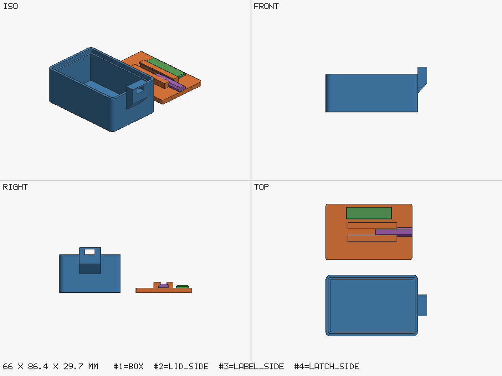

# Latch box: a colour part and a print-in-place latch (Python with parts.py)

A 60 × 40 × 25 mm box with a drop-in lid. The lid carries a separate **label plate** (a part
of its own, so it can take another filament) and a **captive slider latch** printed in place
between two lipped rails; pushed outwards, the latch enters a window in the keeper lug on the box.



## What it shows

- **Parts grouped into one object.** `params.json` names three parts for the `lid` object: the
  lid plate with its rails (main part), the label (`role: fused`, it shares a face with the lid)
  and the latch (`role: free`, 0.3 mm to the rails and 0.4 mm, two layers, above the plate). All
  three are modelled in the lid's frame, so the STLs already hold the assembled positions.
- **Object checks.** `build.py` reports, besides each part's own checks, `A1` for the label (shares
  faces with the lid, no overlap), `A2` for the latch (clear by 0.3 mm), and `D2`/`P1`/`P2` for
  the lid object as a whole: the label's underside is no overhang once it sits on the lid.
- **Seams where they cost nothing.** The label touches the lid on a flat face; with the same
  filament Bambu Studio merges the two into one region per layer (`references/parts.md`). The
  latch is never merged: it keeps its gap.
- **Grouped 3MF.** The core 3MF puts the three lid parts under one parent object with identity
  component transforms; `bambu3mf.py` would write one Bambu object with three parts and a
  per-part filament (not built here: the example names no slicer template).
- **Load-carrying members at the mechanism minimums.** The bar (3.0 mm tall in the direction the
  lid-lift load bends it, 6 mm wide), the rail lips (1.6 mm at the tip, about 2.9 at the root) and
  the lug ceiling over the window (2.5 mm) follow `references/design.md`, "Mechanisms that carry
  load", not the 1.2 mm printability minimum: a field latch built at 1.2 mm broke.
- **The fit check.** The lid drops into the recess inside the box rim: `fit.py` finds no overlap,
  the lid seated on the ledge, and 0.2 mm of play in ±X and ±Y.

## Build

```bash
python3 ../../scripts/build.py run latchbox.py --params params.json --out out --printer ../printers.x2d.json --tools 0
python3 ../../scripts/fit.py out/box.stl out/lid.stl --b-translate 1.8,1.8,22 --min-clearance 0.2
python3 ../place.py out/lid.stl out/lid_side.stl --translate 0,50,0
python3 ../place.py out/label.stl out/label_side.stl --translate 0,50,0
python3 ../place.py out/latch.stl out/latch_side.stl --translate 0,50,0
python3 ../../scripts/preview.py out/box.stl out/lid_side.stl out/label_side.stl out/latch_side.stl -o out/preview.png --overwrite
```

The lid prints top up, flat on the bed; moved by (1.8, 1.8, 22) it sits on the ledge inside the
rim (wall 2.8 − rim 1.6 = 1.2 mm ledge, 0.2 mm clearance per side, 3 mm deep so the lid is flush).
`fit_report.json` is the output of the second command.

Expected: build gate `PASS` with exactly one soft warning, `P2` on the `lid` object: the latch's
underside (144 mm², 2.4 %) is a bridge over the 0.4 mm gap, which is how print-in-place parts
print. Fit gate `PASS`. At delivery the agent says: "label and latch are separate parts of the
lid; to print the label in another colour, select it in the object list and change its filament."
