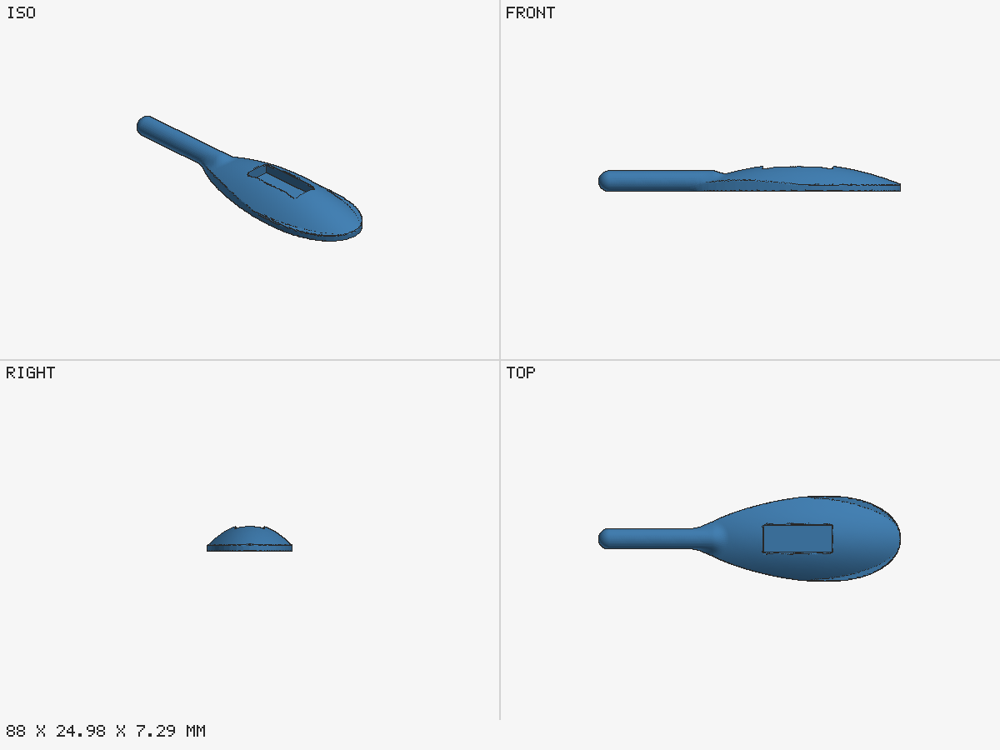

# Leaf door handle (Python with sdf.py)

A leaf-shaped dome with a finger pocket and a round grip, blended into one part. An organic shape,
so the skill uses the Python engine with signed distance functions (`scripts/sdf.py`).



## What it shows

- **One smooth body.** The dome is a height field over the leaf outline, the pocket is subtracted,
  and the grip is joined with `smooth_union` (a 2.5 mm blend), so there is no sharp crease where
  they meet.
- **A watertight mesh from the SDF.** `to_manifold` meshes it at 0.5 mm with a flat floor at
  z = 0, so the part sits on the bed. This shape used to fail the mesh checks with height-field
  booleans; built as one SDF it passes.
- **Honest sizes.** The expected height is 7.3 mm, not the dome's nominal 8 mm: the finger pocket
  cuts away the top of the dome (both noted in `_assumptions`).
- **A soft warning, left for you.** The build passes with one warning, P2: the underside of the
  round grip overhangs. In a real request the skill explains it and lets you choose between
  supports and a redesign, such as a flat under the grip.

## Build

```bash
python3 ../../scripts/build.py run handle.py --params params.json --out out --printer ../printers.x2d.json --tools 0
python3 ../../scripts/preview.py out/handle.stl -o out/preview.png --overwrite
```

Meshing takes about ten seconds. Expected: build gate `PASS`, with the P2 warning above.
