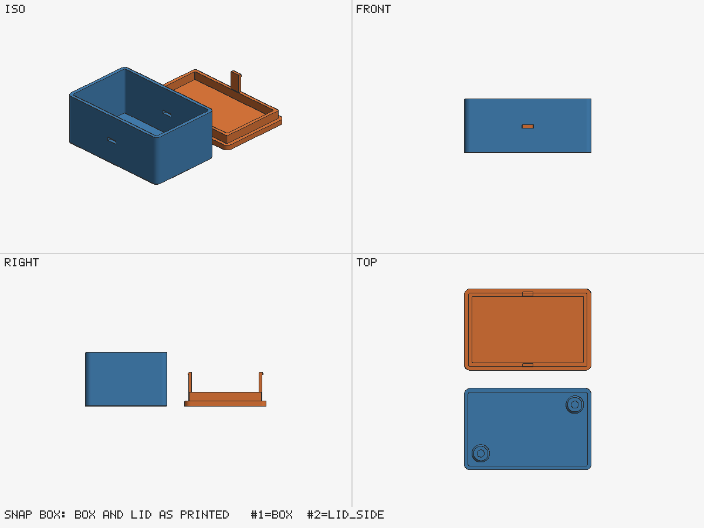

# Snap-fit box (Python with parts.py)

A 70 × 45 × 30 mm box with a lid that snaps on, and two bosses for M3 heat-set inserts. Built with
the Python engine and the part library, `scripts/parts.py`.



## What it shows

- **Part library calls** instead of hand-made geometry: `rounded_box`, `rounded_rect`,
  `bottom_chamfer` (0.4 mm against elephant foot on the bed edge), `standoff(..., "M3", "insert")`,
  `snap_hook` and the matching `snap_window`, and `clean()` for the slivers a flush union leaves.
- **A strain check before building.** `snap_fit_check` computes the hook strain
  (1.5 · t · y / L², about 0.47 %). The hooks print standing up, along Z, the weak direction, so the
  generator refuses anything above half the PLA limit (`references/design.md`, snap fits).
- **Windows placed from the hooks.** Each window is cut where its hook lands once the lid is
  turned over, so the two cannot drift apart when a parameter changes.
- **The fit check.** `fit.py` finds no overlap, the lid seated, and 0.2 mm of play in ±X and ±Y,
  the sliding clearance from `params.json`.

## Build

```bash
python3 ../../scripts/build.py run snapbox.py --params params.json --out out --printer ../printers.x2d.json --tools 0
python3 ../../scripts/fit.py out/box.stl out/lid.stl --b-rotate 180,0,0 --b-translate 0,45,33 --min-clearance 0.2
python3 ../place.py out/lid.stl out/lid_side.stl --translate 0,55,0
python3 ../../scripts/preview.py out/box.stl out/lid_side.stl -o out/preview.png
```

The lid prints plate down with its plug and hooks up. Turned over and moved by (0, 45, 33), it sits
on the box rim (30 mm box + 3 mm plate). `fit_report.json` is the output of the second command.

Expected: build gate `PASS` with no warnings, fit gate `PASS`.
